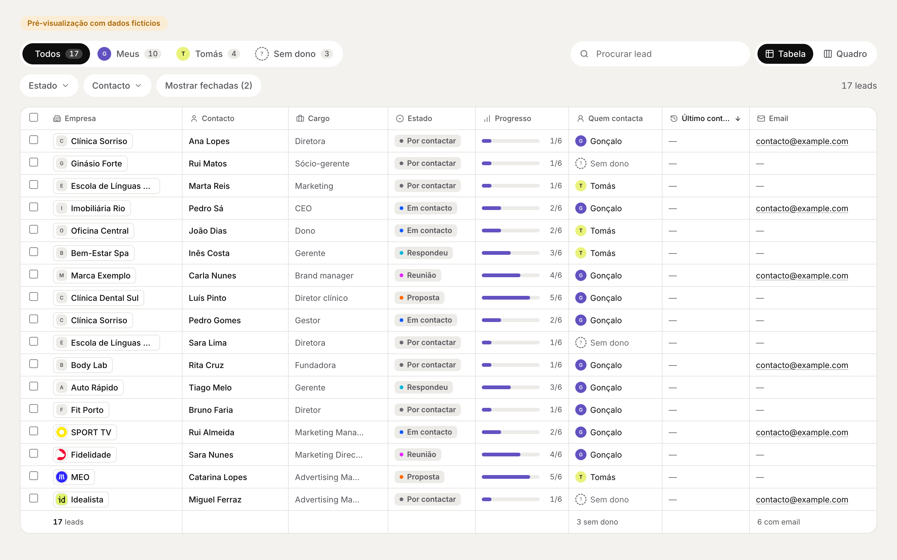
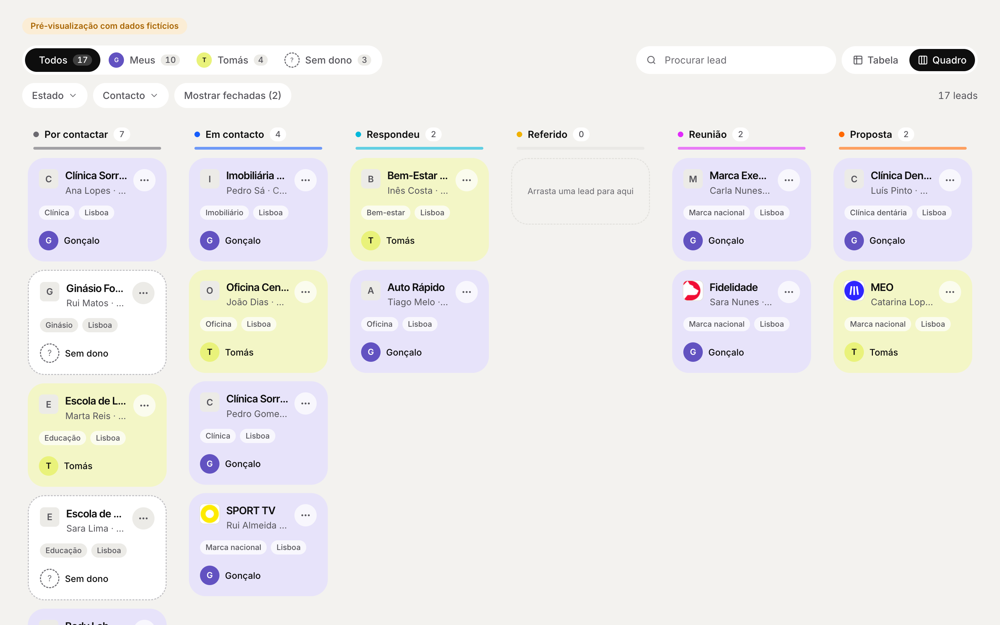
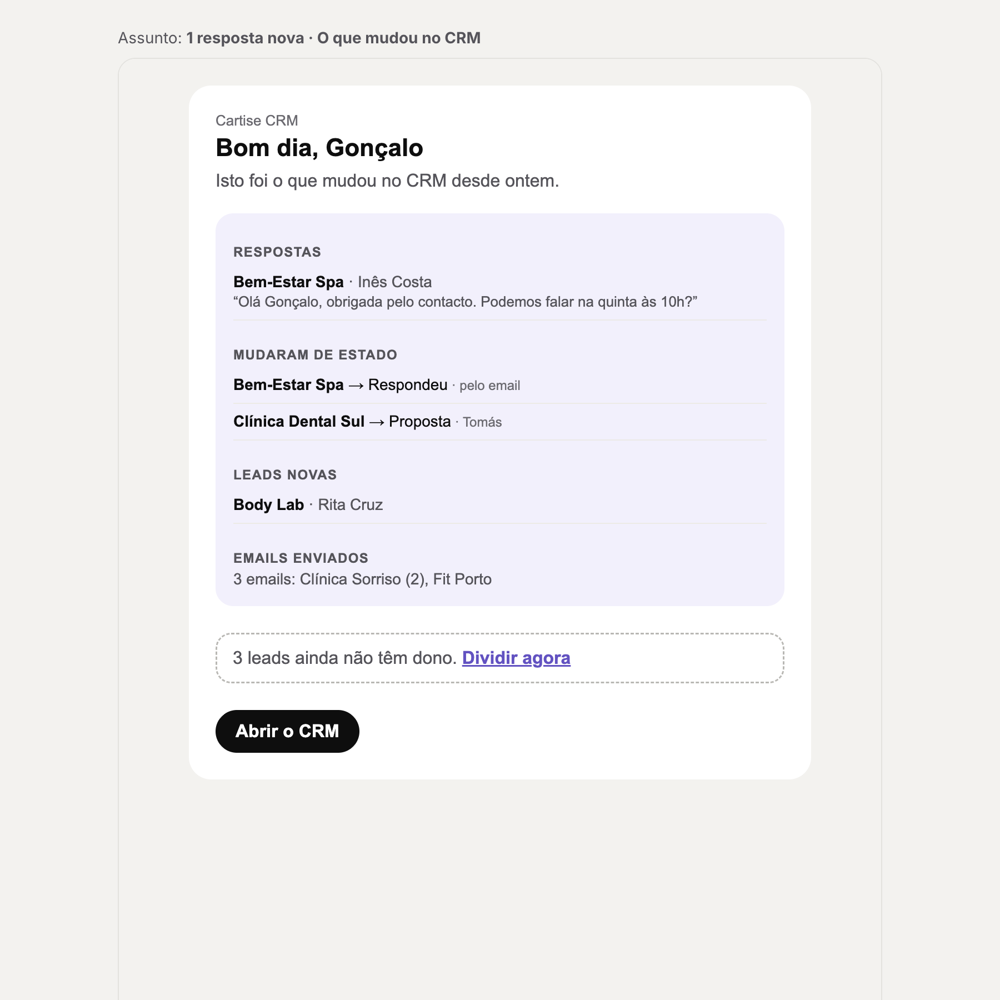
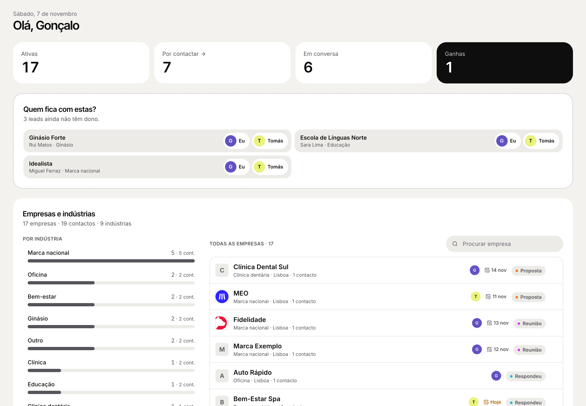
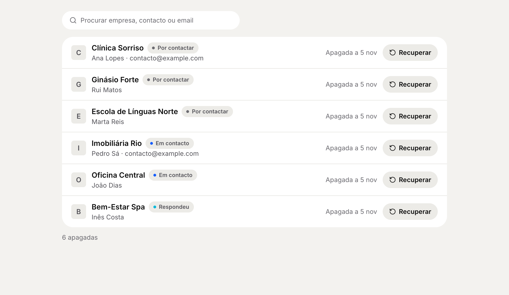

# Cartise CRM

An internal CRM I built for [Cartise](https://www.cartise.pt), a Portuguese start-up that sells advertising on passenger-facing screens inside ride-hailing cars (Uber / Bolt). It runs the company's B2B sales: finding brands, writing to them, following up, and tracking every conversation until a deal closes.

It replaced a spreadsheet-and-inbox workflow for the two founders and is used every day in production.

> The screenshots below use made-up sample data (the app's `/dev` preview pages). The UI is in Portuguese, the language the team works in.



## What it does

- **Pipeline as a table or a board.** A spreadsheet-like, Attio-style table where every field is editable in place (company, contact, stage, owner, industry, email, phone…), with sortable columns, filters, multi-select bulk actions and a per-lead progress bar. Or a drag-and-drop Kanban board by stage.
- **Automatic email logging.** Every 10 minutes a job reads the sales mailbox (Zoho Mail API), matches each email to a lead by address, stores a cleaned copy (quoted thread, signature and legal footer stripped) and moves the lead forward: *To contact → In contact* when we write, *→ Replied* when they answer. Out-of-office replies are recognised and don't count.
- **Daily summary email at 8:30.** Each team member gets what changed in the last 24 hours: replies (with a snippet), stage changes and who made them, new leads, emails sent. Nothing is sent on quiet days.
- **Overview.** Pipeline numbers, leads nobody owns yet (assign in one click), and companies grouped by industry.
- **Safe deletes.** Deleting is a soft archive with an 8-second undo, plus a "deleted leads" page to restore anything later.
- **Spreadsheet import.** Drop an `.xlsx` / `.csv`, map columns, and duplicates (same email) are detected before anything is written.

| Board | Daily email |
|---|---|
|  |  |

| Overview | Deleted leads |
|---|---|
|  |  |

## Stack

- **Next.js 16** (App Router, Server Components, Server Actions, Cache Components) and **React 19** (`useOptimistic` / `useTransition` for instant UI with rollback on error)
- **TypeScript**, **Tailwind CSS 4**
- **Supabase**: Postgres with Row Level Security (only signed-in team members can read or write), Auth, **pg_cron** + **pg_net** for scheduling, **Vault** for the scheduler's token
- **Vercel** for hosting
- **Zoho Mail API** (OAuth refresh-token flow) for the inbox sync, **Resend** for the daily email

## Some engineering details

- **Optimistic, undoable bulk actions.** Moving, assigning or deleting dozens of leads updates the UI immediately; the server action validates ids, returns partial failures, and the UI rolls back only what failed. Every change is written to an activity log shown on the lead's timeline.
- **Idempotent email sync.** `(lead_id, zoho_id)` is unique, a row lock stops overlapping runs, and a cursor per mailbox means each run only reads what's new. Leads are never moved *backwards* (a lead in *Proposal* stays there when a new email arrives).
- **Email cleaning without a parser dependency.** `src/lib/zoho/clean.ts` turns HTML into readable text and cuts quoted threads (Outlook "From:/Sent:", Gmail/Zoho "On … wrote", Portuguese "Em … escreveu"), signatures and footers, with tests in `clean.test.ts` (`npm test`, Node's built-in test runner).
- **Scheduling that survives daylight saving.** Vercel's free cron only runs at a fixed UTC time, so jobs run from Postgres (`pg_cron`). The daily email is triggered at 7:30 and 8:30 UTC and only sends when it's 8 o'clock in Lisbon, so it lands at 8:30 all year.
- **No secrets in code or chat.** The scheduler authenticates with a random token generated inside the database and kept in Supabase Vault; the endpoint checks it through a `security definer` function only the service role can call.
- **Accessibility.** Keyboard-editable cells, labelled controls, `aria-live` status messages, focus management after inline edits.

## Project structure

```
src/
  app/
    (app)/            signed-in app: overview, pipeline, leads, lead pages, server actions
    api/cron/         scheduled jobs: zoho (email sync), digest (daily email)
    api/logo/         company logos, fetched server-side and cached
    dev/              sample-data previews of each screen (development only)
  components/         shared UI (filter bar, popovers, avatars, logos…)
  lib/
    zoho/             Zoho Mail client, email cleaner (+ tests), sync
    digest*.ts        daily email (HTML + text) and its "what changed" query
    lead-filters.ts   filtering / sorting shared by table and board
    fields.ts         validation rules for every editable lead field
supabase/migrations/  schema changes (the base tables pre-date this repo)
```

## Running it locally

```bash
cp .env.example .env.local   # Supabase URL + publishable key
npm install
npm run dev                  # then open http://localhost:3000/dev for the sample-data preview
npm test                     # email-cleaner tests
```

The scheduled jobs also need `SUPABASE_SERVICE_ROLE_KEY`, `ZOHO_CLIENT_ID` / `ZOHO_CLIENT_SECRET` / `ZOHO_REFRESH_TOKEN` and `RESEND_API_KEY` / `DIGEST_FROM` (see the comments in `src/app/api/cron/*/route.ts`).

---

Built by Gonçalo Deus · Head of Growth at Cartise. This is a public snapshot of the private repository, with sample data instead of real contacts.
